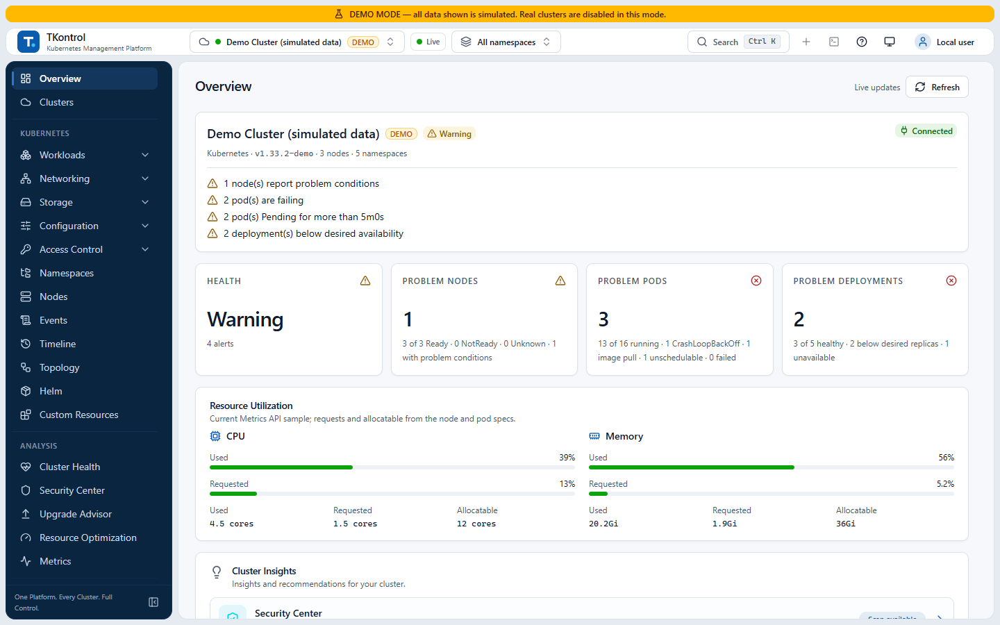
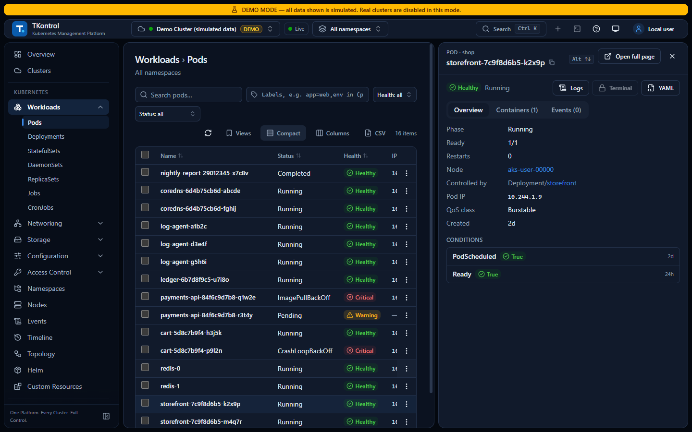
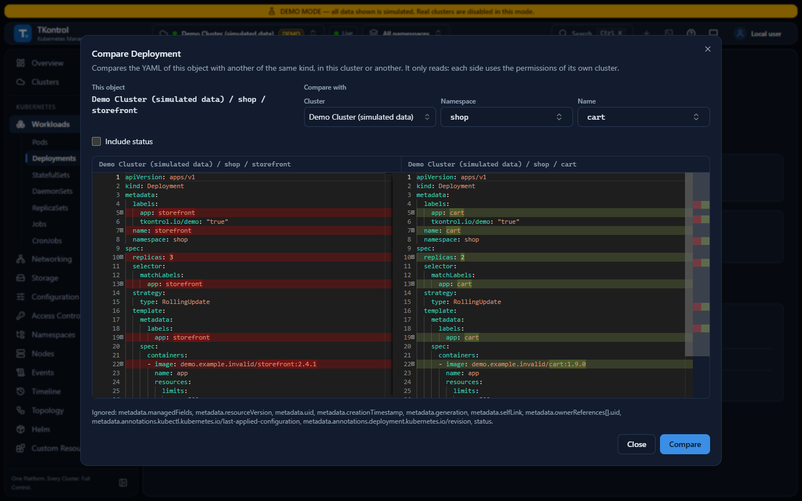
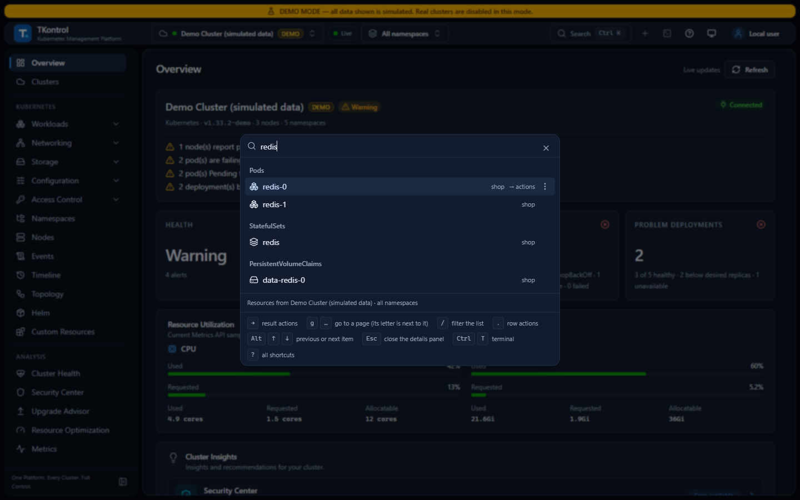
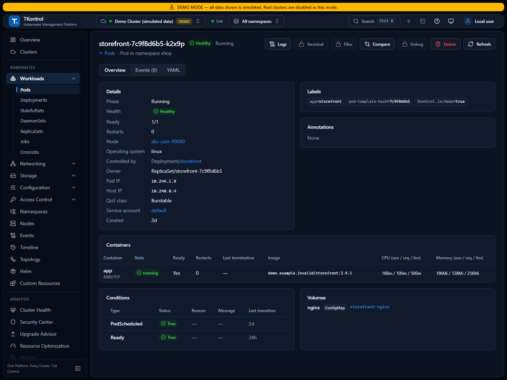

<p align="center">
  
</p>

<h1 align="center">TKontrol</h1>

<p align="center">
  <strong>A Kubernetes desktop for operating AKS clusters in production.</strong><br>
  One Platform. Every Cluster. Full Control.
</p>

<p align="center">
  <a href="https://github.com/tmzrocha/tkontrol-releases/releases/latest"></a>
  <a href="https://github.com/tmzrocha/tkontrol-releases/releases"></a>
  
  
</p>

<p align="center"><b>English</b> · <a href="README.pt-BR.md">Português (Brasil)</a></p>

<picture>
  <source media="(prefers-color-scheme: dark)" srcset="images/overview-dark.png">
  
</picture>

TKontrol is a Windows desktop app to see, operate and troubleshoot Kubernetes clusters. It is built around the way teams run Azure Kubernetes Service (AKS):

- sign-in with Microsoft Entra ID through kubelogin;
- Linux and Windows node pools;
- production clusters, where a wrong click is expensive.

It talks to your clusters with your own kubeconfig, so your cluster's RBAC decides what you can see and do. TKontrol never elevates privileges, installs no agent in your clusters and sends no telemetry.

> [!NOTE]
> This repository hosts the TKontrol installers and the files its in-app updater reads. The source code is not published here.

## Contents

- [Highlights](#highlights)
- [Features](#features)
- [Download and install](#download-and-install)
- [Requirements](#requirements)
- [Getting started](#getting-started)
- [AKS with Microsoft Entra ID](#aks-with-microsoft-entra-id)
- [Security and privacy](#security-and-privacy)
- [Corporate networks](#corporate-networks)
- [Updates](#updates)
- [Keyboard shortcuts](#keyboard-shortcuts)
- [Troubleshooting](#troubleshooting)
- [Support and feedback](#support-and-feedback)
- [License](#license)

## Highlights

- **Made for AKS.**
  - It finds kubelogin and the Azure CLI even outside `PATH`.
  - A failed sign-in is explained by its cause: no `az login`, expired login, Conditional Access, missing tool.
  - It discovers the AKS clusters of your Azure subscription.
  - It handles Linux and Windows nodes, down to the shell and file copy in Windows containers.
- **Careful in production.**
  - The operations on TKontrol's screens (scale, restart, rollback, delete, drain, YAML edits…) check your RBAC permission first and can be simulated on the server (dry run) before you apply them.
  - Deletes and drains, and any action on a production cluster, ask for confirmation in a second step that shows the action, the object, the namespace and the cluster, with a PRD badge.
  - The integrated `kubectl` terminal has its own rule: on a production cluster, a command that may change it runs only after you type the cluster's name.
  - Actions, terminal commands and file copies go to a local audit log. A cluster can be marked read-only in TKontrol, which then refuses every change to it, the terminal included.
- **Honest data.** On the overview and the Clusters page, a count that could not be read (no permission, timeout) shows as "not read", not as zero. When the Metrics API is missing, TKontrol says usage is unavailable instead of making up numbers.
- **Fast on large clusters.** When your permissions allow watching the cluster, a watch cache keeps the lists live without polling, and the global search reads names from it instead of downloading whole lists.
- **Private.** No telemetry. Credentials are encrypted at rest, and the app's backend only listens on your own machine.

## Features

<details open>
<summary><b>See</b></summary>

- **Cluster overview:**
  - health from documented, deterministic rules;
  - nodes, Pods with problems, Deployments;
  - CPU and memory requested, allocatable and used;
  - active issues and grouped warning events.
- **Clusters page:** the health and connection of every registered cluster.
- **Workloads:** Pods, Deployments, StatefulSets, DaemonSets, ReplicaSets, Jobs and CronJobs.
- **Networking:** Services, Ingresses, NetworkPolicies, EndpointSlices and the Gateway API.
- **Storage:** PVCs, PVs and StorageClasses.
- **Configuration:** ConfigMaps, Secrets, ResourceQuotas, LimitRanges, HPAs and PDBs. Lists, details and the YAML view leave Secret values out; you can reveal one key at a time.
- **Access control and more:** ServiceAccounts, Roles and bindings, namespaces, nodes and events; Helm releases and custom resources, read-only.
- **Lists:** live lists, a side panel to inspect an object without leaving the list, saved views and filters you can share as a link.
- **Object pages:** links from a Pod to its node, owner, ServiceAccount, ConfigMaps, Secrets and claims.
- **Relations map and Timeline.** The Timeline joins events and changes. TKontrol keeps it locally, for 24 hours or 7 days, while a cluster is open.
- **Compare an object** with another of the same kind, in the same cluster or another one, without the fields every object differs in (`managedFields`, `resourceVersion`, `uid`…).

</details>

<details>
<summary><b>Operate, with guard rails</b></summary>

- **Changes:**
  - scale, restart and roll back to a chosen revision;
  - delete, cordon, uncordon, and drain (with a plan that respects PDBs);
  - run a CronJob now;
  - edit YAML with a diff, and create objects from YAML;
  - restart and scale several workloads at once.
- **Each of these operations** checks your RBAC permission first and can be simulated on the server (dry run) before you apply it. Deletes and drains, and every change on a production cluster, ask for confirmation in a second step. The dialog of an action on one object shows the equivalent `kubectl` command to copy; YAML edits and bulk deletes don't.
- **In the integrated terminal**, `kubectl` runs the commands your RBAC allows, bound to the selected cluster: it refuses `kubectl config`, plugins, `kubectl proxy` and the flags that change the target or the credentials (`--kubeconfig`, `--context` of another cluster, `--server`, `--token`, `--user`…). On a production cluster, a command that may change it runs only after you type the cluster's name. Each command is audited: the subcommand and its result, never its arguments or output.
- **Audit:** the changes made on the screens, the terminal commands and the file copies go to a local audit log.
- **Read-only mark:** a cluster can be marked read-only in TKontrol, and the backend refuses every change to it, the terminal included.

</details>

<details>
<summary><b>Troubleshoot</b></summary>

- Logs:
  - streaming, with pause, filter, previous container and download;
  - merged logs of a Deployment, StatefulSet, DaemonSet or Job.
- A `kubectl` terminal bound to the selected cluster, a Pod shell (Linux and Windows) and port forwarding.
- Copy files to and from a container (Linux and Windows).
- Debug a Pod with an ephemeral container, from images such as busybox or netshoot, or from your own registry.
- Diagnosis with the probable cause and the evidence for Pods, Deployments, nodes, Services and PVCs.
- Packet capture:
  - Linux Pods and nodes with tcpdump, saved as PCAP;
  - Windows nodes with `netsh trace`, saved as ETL.

</details>

<details>
<summary><b>Analyze</b></summary>

The scanners ship inside the installer, run on your machine and install nothing in your clusters.

- **Cluster Health**, with Popeye and Polaris.
- **Security Center**, with Trivy (image vulnerabilities) and KubeLinter.
- **Upgrade Advisor** for the next Kubernetes version, with Pluto and Kubeconform. It can also run Azure checks: quota, subnet capacity, maintenance windows and locks.

</details>

<details>
<summary><b>Several clusters, search and keyboard</b></summary>

- Switch clusters from the header, open a cluster in a window of its own, and compare objects across clusters.
- The global search (<kbd>Ctrl</kbd>+<kbd>K</kbd>):
  - finds pages and the objects of 12 kinds;
  - acts on what it finds: open, YAML, a Pod's logs and terminal, copy `kubectl get`;
  - lists the objects you opened lately.
- Keyboard first: <kbd>g</kbd> + a letter goes to a page, <kbd>J</kbd>/<kbd>K</kbd> move through rows, <kbd>.</kbd> opens a row's actions, <kbd>?</kbd> lists every shortcut.
- English and Portuguese (Brazil), light and dark themes.

</details>

<table>
  <tr>
    <td width="50%"></td>
    <td width="50%"></td>
  </tr>
  <tr>
    <td>Live lists, with a side panel to inspect an object.</td>
    <td>Compare an object with another, in this cluster or another.</td>
  </tr>
  <tr>
    <td width="50%"></td>
    <td width="50%"></td>
  </tr>
  <tr>
    <td>Search objects of 12 kinds and act on them.</td>
    <td>Object pages link to what the object uses.</td>
  </tr>
</table>

<sub>The screenshots use Demo Mode, with simulated data.</sub>

## Download and install

1. Open the [latest release](https://github.com/tmzrocha/tkontrol-releases/releases/latest).
2. Download one installer:

   | File | When to use it |
   |---|---|
   | `TKontrol_<version>_x64-setup.exe` (about 99 MB) | **Recommended.** Installs for your user, needs no administrator rights and updates itself from inside the app. |
   | `TKontrol_<version>_x64_en-US.msi` (about 143 MB) | For distribution by IT (Intune, Group Policy). |

3. Run it. The installers are not Authenticode-signed yet, so Windows SmartScreen may show "Windows protected your PC". Choose **More info → Run anyway**.
4. Open **TKontrol** from the Start menu.

### Verify the download

Each release lists the SHA-256 of its files in `SHA256SUMS.txt`. In PowerShell:

```powershell
Get-FileHash .\TKontrol_<version>_x64-setup.exe -Algorithm SHA256
```

The hash must match the line of that file in `SHA256SUMS.txt`. Each release also includes a CycloneDX SBOM (`sbom.cdx.json`) of everything inside the app, the bundled scanners included.

## Requirements

- **Windows:** 10 or 11, 64-bit. TKontrol is tested on Windows 11.
- **WebView2:** part of Windows 11. On Windows 10, the installer downloads it if it is missing.
- **A kubeconfig** with access to your clusters.
- **For AKS with Microsoft Entra ID:** the Azure CLI and kubelogin.
- **Optional:** the Metrics API (metrics-server), for usage numbers.

## Getting started

1. Open TKontrol. A short tour shows the main screens.
2. To look around without a cluster, choose **Explore Demo Mode** in the tray icon menu. It shows simulated data only, and the app returns to your clusters when you leave it.
3. On the **Clusters** page, choose **Import kubeconfig**. You can:
   - pick contexts from your `~/.kube/config`;
   - paste or upload a kubeconfig;
   - import the AKS clusters of your Azure subscription.
4. Choose the cluster and the namespaces in the header.

Each imported context is stored on its own, encrypted. TKontrol follows the changes you make to your local `~/.kube/config`.

## AKS with Microsoft Entra ID

- **Get the kubeconfig:** use `az aks get-credentials`, then convert it with `kubelogin convert-kubeconfig -l azurecli`.
- **Sign in:** run `az login` before connecting.
- **Supported sign-in modes:** TKontrol runs kubelogin without prompts, with `azurecli`, `spn`, `msi`, `workloadidentity` or `azd`.
- **Refused modes:** `devicecode` and `interactive`, because they would wait for input that never comes.
- **Finding the tools:**
  - kubelogin and the Azure CLI are found on `PATH` or in their default install folders;
  - to point at a specific one, set `TKONTROL_KUBELOGIN_PATH` or `TKONTROL_AZ_PATH`.
- **When a connection fails**, **Diagnose**, on the cluster, names the cause and lists what to check.

## Security and privacy

- **No privilege elevation.** Every call to a cluster uses the credentials of the imported context; TKontrol has no administrative identity of its own.
- **Credentials:**
  - encrypted at rest with AES-256-GCM;
  - never shown again or written to logs.
- **Data folder:** credentials and the encryption key stay in `%AppData%\TKontrol`, outside OneDrive.
- **Local only.** The app's backend listens on a random port of `127.0.0.1`, protected by a session token created at each start.
- **Secrets.** Lists, details and the YAML view never receive Secret values. You can reveal one key at a time, if the cluster's RBAC allows it; it hides again after 30 seconds. The YAML editor refuses Secrets. The integrated terminal runs `kubectl` with your RBAC, so it shows what `kubectl` would show.
- **No telemetry.** No usage data, crash report or identifier is collected or sent. TKontrol only connects to:
  - your clusters;
  - Azure Resource Manager and Microsoft sign-in, when you discover AKS clusters or run the Azure checks;
  - GitHub Releases, for the update check, which you can turn off;
  - the Trivy vulnerability database and your image registries, in a Security Center scan;
  - the Kubeconform schemas, in an Upgrade Advisor scan.
- **Local data.** `%AppData%\TKontrol` holds:
  - the registered clusters and the encrypted credentials;
  - the audit log;
  - scan results;
  - the Timeline history, 7 days by default.

  The uninstaller removes this data only when you choose **Delete the application data**.

## Corporate networks

- **Proxy:** set `HTTPS_PROXY` and `NO_PROXY` as Windows environment variables, not only in a terminal profile. The app and every tool it starts use them. A `proxy-url` in the kubeconfig is honored, `socks5://` included.
- **Corporate CA:** the calls to Azure, GitHub, Trivy and Kubeconform trust the Windows certificate store, where IT installs the corporate CA.
- **Connection to a cluster:** it trusts only the CA in the kubeconfig. So a TLS-inspecting proxy cannot sit between TKontrol and the API server: add the cluster to `NO_PROXY`.

## Updates

- **When:** about 20 seconds after opening, and whenever you choose **Check for updates** in the tray icon menu.
- **What it sends:** the check downloads `latest.json` from this repository and sends nothing about you or your machine.
- **Installing:** TKontrol always asks before installing. It only accepts packages signed with the project's updater key.
- **Turning it off:**
  - for your user: **Settings → Updates**;
  - for an organization: `TKONTROL_NO_UPDATE_CHECK=1`, which turns off every check.

## Keyboard shortcuts

| Keys | Action |
|---|---|
| <kbd>Ctrl</kbd>+<kbd>K</kbd> | Global search |
| <kbd>?</kbd> | All shortcuts |
| <kbd>g</kbd> then a letter | Go to a page (the letter is shown next to it in the search) |
| <kbd>/</kbd> | Filter the list |
| <kbd>J</kbd> / <kbd>K</kbd>, <kbd>↑</kbd> / <kbd>↓</kbd> | Move through the rows |
| <kbd>Enter</kbd> | Open the selected row |
| <kbd>.</kbd> | Actions of the selected row |
| <kbd>Alt</kbd>+<kbd>↑</kbd> / <kbd>↓</kbd> | Previous or next object, with the side panel open |
| <kbd>Ctrl</kbd>+<kbd>T</kbd> | Show or hide the terminal |
| <kbd>Ctrl</kbd>+<kbd>R</kbd> | Refresh |
| <kbd>Ctrl</kbd>+<kbd>N</kbd> | Create objects from YAML |
| <kbd>Ctrl</kbd>+<kbd>[</kbd> / <kbd>]</kbd> | Back / forward |

## Troubleshooting

- **"Windows protected your PC" when installing.** Expected while the installers are not Authenticode-signed: **More info → Run anyway**. Check the file against `SHA256SUMS.txt` first.
- **An AKS cluster does not connect.** Run `az login` in the account with access to the cluster, then **Connect** again. **Diagnose**, on the cluster, shows the cause.
- **No CPU or memory usage.** The cluster has no Metrics API (metrics-server), or your user cannot read it. TKontrol shows that usage is unavailable, with the reason.
- **Logs.** The app backend writes to `%LOCALAPPDATA%\com.tomazrocha.tkontrol\logs\backend.log`.

## Support and feedback

Open an [issue](https://github.com/tmzrocha/tkontrol-releases/issues) with:

- the TKontrol version (**Settings**, TKontrol card, **Version**);
- what you did and what happened;
- a screenshot.

> [!WARNING]
> Never attach a kubeconfig, tokens, `tkontrol.db` or `secret.key`.

## License

No license has been published for TKontrol yet; until then, all rights are reserved by the author. The bundled scanners (Popeye, Polaris, Trivy, KubeLinter, Pluto and Kubeconform) keep their own licenses, which ship with the app.

Kubernetes is a registered trademark of The Linux Foundation. Azure, AKS and Windows are trademarks of Microsoft. TKontrol is not affiliated with or endorsed by either of them.

Made by Tomaz Rocha.
