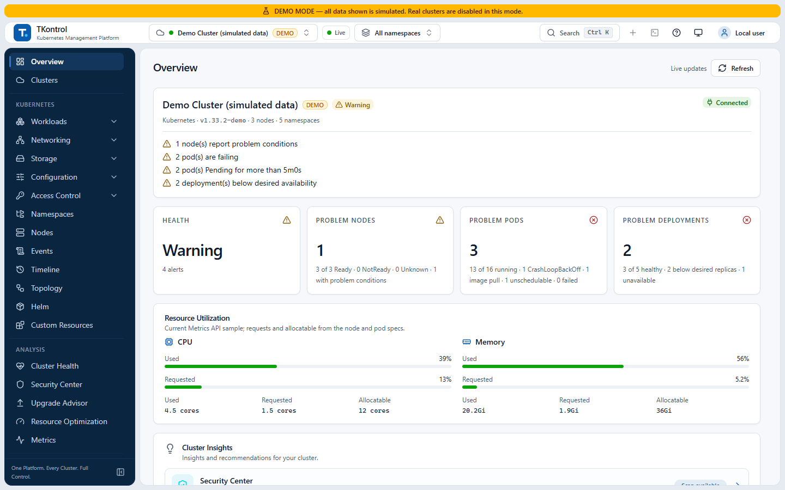
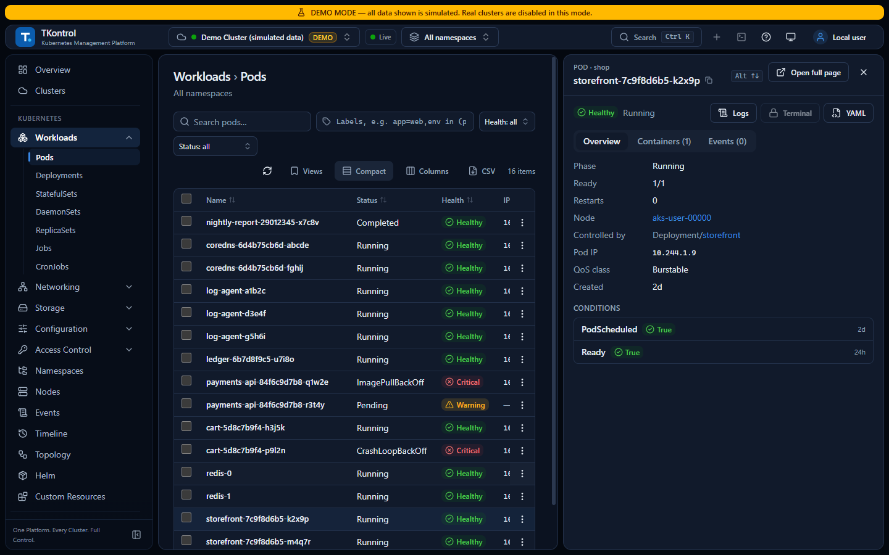
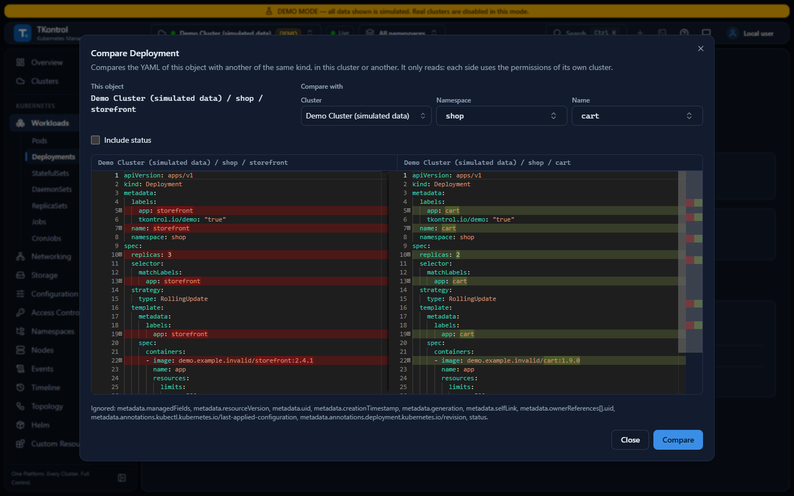
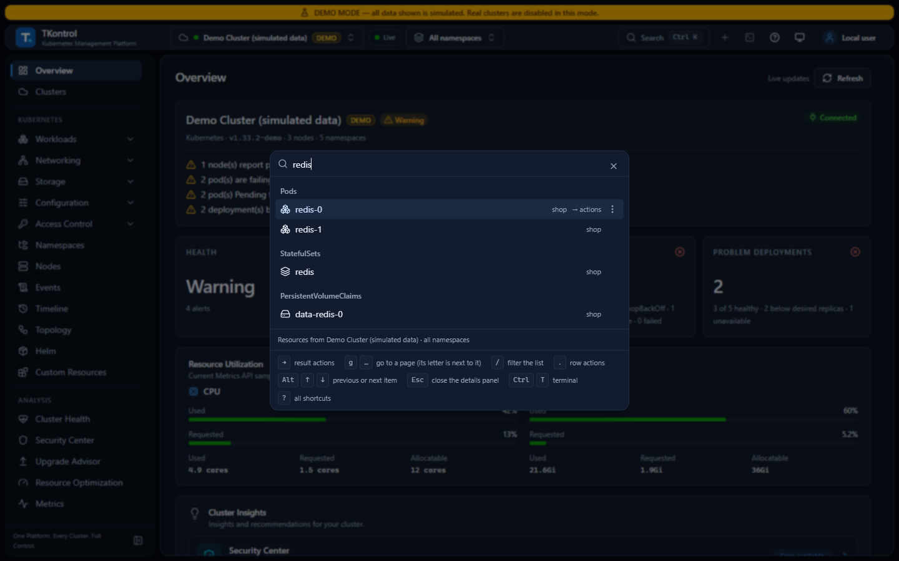
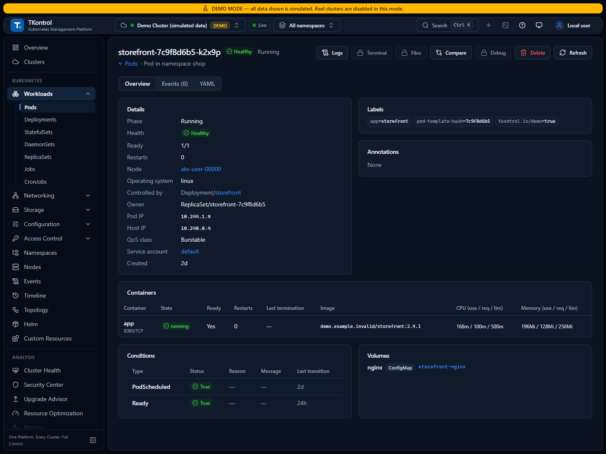

<p align="center">
  
</p>

<h1 align="center">TKontrol</h1>

<p align="center">
  <strong>Um desktop Kubernetes para operar clusters AKS em produção.</strong><br>
  One Platform. Every Cluster. Full Control.
</p>

<p align="center">
  <a href="https://github.com/tmzrocha/tkontrol-releases/releases/latest"></a>
  <a href="https://github.com/tmzrocha/tkontrol-releases/releases"></a>
  
  
</p>

<p align="center"><a href="README.md">English</a> · <b>Português (Brasil)</b></p>

<picture>
  <source media="(prefers-color-scheme: dark)" srcset="images/overview-dark.png">
  
</picture>

O TKontrol é um app desktop para Windows que mostra, opera e diagnostica clusters Kubernetes. Ele foi pensado para o jeito como as equipes usam o Azure Kubernetes Service (AKS):

- login com o Microsoft Entra ID pelo kubelogin;
- node pools Linux e Windows;
- clusters de produção, onde um clique errado custa caro.

Ele acessa os clusters com o seu próprio kubeconfig, então é o RBAC do cluster que decide o que você vê e faz. O TKontrol nunca eleva privilégios, não instala agente nos clusters e não envia telemetria.

> [!NOTE]
> Este repositório guarda os instaladores do TKontrol e os arquivos que o atualizador do app lê. O código-fonte não é publicado aqui.

## Conteúdo

- [Destaques](#destaques)
- [Recursos](#recursos)
- [Baixar e instalar](#baixar-e-instalar)
- [Requisitos](#requisitos)
- [Primeiros passos](#primeiros-passos)
- [AKS com Microsoft Entra ID](#aks-com-microsoft-entra-id)
- [Segurança e privacidade](#segurança-e-privacidade)
- [Redes corporativas](#redes-corporativas)
- [Atualizações](#atualizações)
- [Atalhos de teclado](#atalhos-de-teclado)
- [Solução de problemas](#solução-de-problemas)
- [Suporte e sugestões](#suporte-e-sugestões)
- [Licença](#licença)

## Destaques

- **Feito para o AKS.**
  - Encontra o kubelogin e o Azure CLI mesmo fora do `PATH`.
  - Um login que falha é explicado pela causa: sem `az login`, login expirado, Acesso Condicional, ferramenta ausente.
  - Descobre os clusters AKS da sua assinatura do Azure.
  - Trata nodes Linux e Windows, inclusive o shell e a cópia de arquivos em contêineres Windows.
- **Cuidadoso em produção.**
  - As operações nas telas do TKontrol (escalar, reiniciar, rollback, excluir, drenar, editar YAML…) conferem primeiro a sua permissão no RBAC e podem ser simuladas no servidor (dry run) antes de aplicar.
  - Excluir e drenar, e qualquer ação num cluster de produção, pedem confirmação numa segunda tela com a ação, o objeto, o namespace e o cluster, com o selo PRD.
  - O terminal `kubectl` integrado tem regra própria: num cluster de produção, um comando que pode alterá-lo só roda depois de você digitar o nome do cluster.
  - Ações, comandos do terminal e cópias de arquivos vão para um log de auditoria local. Um cluster pode ser marcado como somente leitura no TKontrol, que então recusa qualquer alteração nele, inclusive pelo terminal.
- **Dados honestos.** Na visão geral e na tela Clusters, uma contagem que não pôde ser lida (sem permissão, tempo esgotado) aparece como "não lido", e não como zero. Sem a Metrics API, o TKontrol diz que o uso está indisponível, em vez de inventar números.
- **Rápido em clusters grandes.** Quando as suas permissões deixam acompanhar o cluster (watch), um cache mantém as listas ao vivo sem consultas repetidas, e a busca global lê os nomes dele, sem baixar listas inteiras.
- **Privado.** Sem telemetria. As credenciais ficam criptografadas, e o backend do app só escuta na sua própria máquina.

## Recursos

<details open>
<summary><b>Ver</b></summary>

- **Visão geral do cluster:**
  - saúde por regras determinísticas e documentadas;
  - nodes, Pods com problema, Deployments;
  - CPU e memória requisitadas, alocáveis e usadas;
  - problemas ativos e eventos de aviso agrupados.
- **Tela Clusters:** a saúde e a conexão de todos os clusters cadastrados.
- **Workloads:** Pods, Deployments, StatefulSets, DaemonSets, ReplicaSets, Jobs e CronJobs.
- **Rede:** Services, Ingresses, NetworkPolicies, EndpointSlices e Gateway API.
- **Armazenamento:** PVCs, PVs e StorageClasses.
- **Configuração:** ConfigMaps, Secrets, ResourceQuotas, LimitRanges, HPAs e PDBs. Listas, detalhes e YAML deixam de fora os valores dos Secrets; você pode revelar uma chave por vez.
- **Controle de acesso e mais:** ServiceAccounts, Roles e bindings, namespaces, nodes e eventos; releases Helm e custom resources, só leitura.
- **Listas:** listas ao vivo, um painel lateral para examinar um objeto sem sair da lista, visões salvas e filtros que podem ser compartilhados como link.
- **Páginas de objeto:** links do Pod para o node, o dono, a ServiceAccount, os ConfigMaps, os Secrets e os PVCs.
- **Mapa de relações e Timeline.** A Timeline junta eventos e alterações. O TKontrol a guarda localmente, por 24 horas ou 7 dias, enquanto um cluster está aberto.
- **Comparar um objeto** com outro do mesmo tipo, no mesmo cluster ou em outro, sem os campos em que todo objeto difere (`managedFields`, `resourceVersion`, `uid`…).

</details>

<details>
<summary><b>Operar, com proteções</b></summary>

- **Alterações:**
  - escalar, reiniciar e fazer rollback para uma revisão escolhida;
  - excluir, cordon, uncordon e drain (com um plano que respeita os PDBs);
  - executar um CronJob agora;
  - editar YAML com diff e criar objetos a partir de YAML;
  - reiniciar e escalar vários workloads de uma vez.
- **Cada uma dessas operações** confere primeiro a sua permissão no RBAC e pode ser simulada no servidor (dry run) antes de aplicar. Excluir e drenar, e qualquer alteração num cluster de produção, pedem confirmação numa segunda tela. O diálogo de uma ação num objeto mostra o comando `kubectl` equivalente para copiar; a edição de YAML e as exclusões em lote, não.
- **No terminal integrado**, o `kubectl` roda os comandos que o seu RBAC permite, preso ao cluster selecionado: recusa `kubectl config`, plugins, `kubectl proxy` e as opções que trocam o destino ou a credencial (`--kubeconfig`, `--context` de outro cluster, `--server`, `--token`, `--user`…). Num cluster de produção, um comando que pode alterá-lo só roda depois de você digitar o nome do cluster. Cada comando é auditado: o subcomando e o resultado, nunca os argumentos ou a saída.
- **Auditoria:** as alterações feitas nas telas, os comandos do terminal e as cópias de arquivos vão para um log de auditoria local.
- **Marca de somente leitura:** um cluster pode ser marcado como somente leitura no TKontrol, e o backend recusa qualquer alteração nele, inclusive pelo terminal.

</details>

<details>
<summary><b>Diagnosticar</b></summary>

- Logs:
  - em tempo real, com pausa, filtro, contêiner anterior e download;
  - logs juntos de um Deployment, StatefulSet, DaemonSet ou Job.
- Um terminal `kubectl` preso ao cluster selecionado, shell no Pod (Linux e Windows) e port-forward.
- Copiar arquivos de e para um contêiner (Linux e Windows).
- Depurar um Pod com um contêiner efêmero, com imagens como busybox ou netshoot, ou do seu próprio registry.
- Diagnóstico com a causa provável e as evidências para Pods, Deployments, nodes, Services e PVCs.
- Captura de pacotes:
  - Pods e nodes Linux com tcpdump, salvo em PCAP;
  - nodes Windows com `netsh trace`, salvo em ETL.

</details>

<details>
<summary><b>Analisar</b></summary>

Os scanners vêm no instalador, rodam na sua máquina e não instalam nada nos clusters.

- **Saúde do cluster**, com Popeye e Polaris.
- **Central de segurança**, com Trivy (vulnerabilidades de imagens) e KubeLinter.
- **Assistente de upgrade** para a próxima versão do Kubernetes, com Pluto e Kubeconform. Também pode fazer verificações no Azure: cota, capacidade da subnet, janelas de manutenção e locks.

</details>

<details>
<summary><b>Vários clusters, busca e teclado</b></summary>

- Troque de cluster pelo cabeçalho, abra um cluster numa janela própria e compare objetos entre clusters.
- A busca global (<kbd>Ctrl</kbd>+<kbd>K</kbd>):
  - acha páginas e os objetos de 12 tipos;
  - age sobre o que acha: abrir, YAML, logs e terminal de um Pod, copiar o `kubectl get`;
  - lista os objetos abertos por último.
- Teclado em primeiro lugar: <kbd>g</kbd> + uma letra leva a uma página, <kbd>J</kbd>/<kbd>K</kbd> percorrem as linhas, <kbd>.</kbd> abre as ações da linha, <kbd>?</kbd> lista todos os atalhos.
- Português (Brasil) e inglês, temas claro e escuro.

</details>

<table>
  <tr>
    <td width="50%"></td>
    <td width="50%"></td>
  </tr>
  <tr>
    <td>Listas ao vivo, com painel lateral para examinar um objeto.</td>
    <td>Compare um objeto com outro, neste cluster ou em outro.</td>
  </tr>
  <tr>
    <td width="50%"></td>
    <td width="50%"></td>
  </tr>
  <tr>
    <td>Busque objetos de 12 tipos e aja sobre eles.</td>
    <td>As páginas de objeto levam ao que o objeto usa.</td>
  </tr>
</table>

<sub>As capturas usam o Modo Demo, com dados simulados, e a interface em inglês.</sub>

## Baixar e instalar

1. Abra a [última versão](https://github.com/tmzrocha/tkontrol-releases/releases/latest).
2. Baixe um instalador:

   | Arquivo | Quando usar |
   |---|---|
   | `TKontrol_<versão>_x64-setup.exe` (cerca de 99 MB) | **Recomendado.** Instala para o seu usuário, não pede permissão de administrador e se atualiza pelo próprio app. |
   | `TKontrol_<versão>_x64_en-US.msi` (cerca de 143 MB) | Para distribuição pela TI (Intune, Política de Grupo). |

3. Execute. Os instaladores ainda não têm assinatura Authenticode, então o SmartScreen do Windows pode mostrar "O Windows protegeu o computador". Escolha **Mais informações → Executar assim mesmo**.
4. Abra o **TKontrol** pelo Menu Iniciar.

### Conferir o download

Cada versão lista o SHA-256 dos seus arquivos em `SHA256SUMS.txt`. No PowerShell:

```powershell
Get-FileHash .\TKontrol_<versão>_x64-setup.exe -Algorithm SHA256
```

O hash precisa ser igual ao da linha do arquivo em `SHA256SUMS.txt`. Cada versão também traz um SBOM CycloneDX (`sbom.cdx.json`) com tudo o que há dentro do app, inclusive os scanners empacotados.

## Requisitos

- **Windows:** 10 ou 11, 64 bits. O TKontrol é testado no Windows 11.
- **WebView2:** já vem no Windows 11. No Windows 10, o instalador o baixa se faltar.
- **Um kubeconfig** com acesso aos seus clusters.
- **Para AKS com Microsoft Entra ID:** o Azure CLI e o kubelogin.
- **Opcional:** a Metrics API (metrics-server), para os números de uso.

## Primeiros passos

1. Abra o TKontrol. Um tour curto mostra as telas principais.
2. Para conhecer sem um cluster, escolha **Explorar o Modo Demo** no menu do ícone da bandeja. Ele mostra só dados simulados, e o app volta aos seus clusters quando você sai dele.
3. Na tela **Clusters**, escolha **Importar kubeconfig**. Você pode:
   - escolher contextos do seu `~/.kube/config`;
   - colar ou enviar um kubeconfig;
   - importar os clusters AKS da sua assinatura do Azure.
4. Escolha o cluster e os namespaces no cabeçalho.

Cada contexto importado é guardado à parte, criptografado. O TKontrol acompanha as mudanças que você faz no seu `~/.kube/config` local.

## AKS com Microsoft Entra ID

- **Obter o kubeconfig:** use `az aks get-credentials` e converta com `kubelogin convert-kubeconfig -l azurecli`.
- **Entrar:** faça `az login` antes de conectar.
- **Modos de login aceitos:** o TKontrol roda o kubelogin sem pedir nada, com `azurecli`, `spn`, `msi`, `workloadidentity` ou `azd`.
- **Modos recusados:** `devicecode` e `interactive`, porque ficariam esperando uma entrada que não vem.
- **Onde encontra as ferramentas:**
  - o kubelogin e o Azure CLI são encontrados no `PATH` ou nas pastas de instalação padrão;
  - para indicar um específico, defina `TKONTROL_KUBELOGIN_PATH` ou `TKONTROL_AZ_PATH`.
- **Quando a conexão falha**, **Diagnosticar**, no cluster, diz a causa e o que verificar.

## Segurança e privacidade

- **Sem elevação de privilégio.** Toda chamada a um cluster usa as credenciais do contexto importado; o TKontrol não tem identidade administrativa própria.
- **Credenciais:**
  - criptografadas com AES-256-GCM;
  - nunca mostradas de novo nem gravadas em logs.
- **Pasta de dados:** as credenciais e a chave que as protege ficam em `%AppData%\TKontrol`, fora do OneDrive.
- **Só local.** O backend do app escuta numa porta aleatória de `127.0.0.1`, protegido por um token de sessão criado a cada abertura.
- **Secrets.** Listas, detalhes e YAML nunca recebem os valores dos Secrets. Você pode revelar uma chave por vez, se o RBAC do cluster permitir; ela some de novo depois de 30 segundos. O editor de YAML recusa Secrets. O terminal integrado roda o `kubectl` com o seu RBAC, então mostra o que o `kubectl` mostraria.
- **Sem telemetria.** Nenhum dado de uso, relatório de falha ou identificador é coletado ou enviado. O TKontrol só se conecta a:
  - os seus clusters;
  - o Azure Resource Manager e o login da Microsoft, quando você descobre clusters AKS ou faz as verificações do Azure;
  - o GitHub Releases, para procurar atualizações, o que pode ser desligado;
  - a base de vulnerabilidades do Trivy e os seus registries de imagens, numa análise da Central de segurança;
  - os schemas do Kubeconform, numa análise do Assistente de upgrade.
- **Dados locais.** `%AppData%\TKontrol` guarda:
  - os clusters cadastrados e as credenciais criptografadas;
  - o log de auditoria;
  - os resultados das análises;
  - o histórico da Timeline, 7 dias por padrão.

  O desinstalador só apaga esses dados se você marcar **Delete the application data**.

## Redes corporativas

- **Proxy:** defina `HTTPS_PROXY` e `NO_PROXY` nas variáveis de ambiente do Windows, e não só no perfil de um terminal. O app e todas as ferramentas que ele inicia as usam. O `proxy-url` do kubeconfig é respeitado, inclusive `socks5://`.
- **CA corporativa:** as chamadas ao Azure, ao GitHub, ao Trivy e ao Kubeconform confiam no repositório de certificados do Windows, onde a TI instala a CA corporativa.
- **Conexão com um cluster:** ela confia só na CA do kubeconfig. Por isso, um proxy que inspeciona TLS não pode ficar entre o TKontrol e o API server: coloque o cluster em `NO_PROXY`.

## Atualizações

- **Quando:** cerca de 20 segundos depois de abrir, e sempre que você escolhe **Procurar atualizações** no menu do ícone da bandeja.
- **O que é enviado:** a verificação baixa o `latest.json` deste repositório e não envia nada sobre você ou a sua máquina.
- **Instalação:** o TKontrol sempre pergunta antes de instalar. Ele só aceita pacotes assinados com a chave do atualizador do projeto.
- **Desligar:**
  - para o seu usuário: **Preferências → Atualizações**;
  - para uma organização: `TKONTROL_NO_UPDATE_CHECK=1`, que desliga toda verificação.

## Atalhos de teclado

| Teclas | Ação |
|---|---|
| <kbd>Ctrl</kbd>+<kbd>K</kbd> | Busca global |
| <kbd>?</kbd> | Todos os atalhos |
| <kbd>g</kbd> e depois uma letra | Ir a uma página (a letra aparece ao lado dela na busca) |
| <kbd>/</kbd> | Filtrar a lista |
| <kbd>J</kbd> / <kbd>K</kbd>, <kbd>↑</kbd> / <kbd>↓</kbd> | Percorrer as linhas |
| <kbd>Enter</kbd> | Abrir a linha selecionada |
| <kbd>.</kbd> | Ações da linha selecionada |
| <kbd>Alt</kbd>+<kbd>↑</kbd> / <kbd>↓</kbd> | Objeto anterior ou próximo, com o painel lateral aberto |
| <kbd>Ctrl</kbd>+<kbd>T</kbd> | Mostrar ou esconder o terminal |
| <kbd>Ctrl</kbd>+<kbd>R</kbd> | Atualizar |
| <kbd>Ctrl</kbd>+<kbd>N</kbd> | Criar objetos a partir de YAML |
| <kbd>Ctrl</kbd>+<kbd>[</kbd> / <kbd>]</kbd> | Voltar / avançar |

## Solução de problemas

- **"O Windows protegeu o computador" ao instalar.** Esperado enquanto os instaladores não têm assinatura Authenticode: **Mais informações → Executar assim mesmo**. Antes, confira o arquivo com o `SHA256SUMS.txt`.
- **Um cluster AKS não conecta.** Faça `az login` na conta com acesso ao cluster e clique em **Conectar** de novo. **Diagnosticar**, no cluster, mostra a causa.
- **Sem uso de CPU ou memória.** O cluster não tem a Metrics API (metrics-server), ou o seu usuário não pode lê-la. O TKontrol mostra que o uso está indisponível, com o motivo.
- **Logs.** O backend do app grava em `%LOCALAPPDATA%\com.tomazrocha.tkontrol\logs\backend.log`.

## Suporte e sugestões

Abra uma [issue](https://github.com/tmzrocha/tkontrol-releases/issues) com:

- a versão do TKontrol (**Preferências**, cartão TKontrol, **Versão**);
- o que você fez e o que aconteceu;
- um print da tela.

> [!WARNING]
> Nunca anexe kubeconfig, tokens, `tkontrol.db` ou `secret.key`.

## Licença

O TKontrol ainda não tem uma licença publicada; até lá, todos os direitos são reservados ao autor. Os scanners empacotados (Popeye, Polaris, Trivy, KubeLinter, Pluto e Kubeconform) seguem as próprias licenças, que acompanham o app.

Kubernetes é marca registrada da The Linux Foundation. Azure, AKS e Windows são marcas da Microsoft. O TKontrol não é afiliado a nenhuma delas nem endossado por elas.

Feito por Tomaz Rocha.
